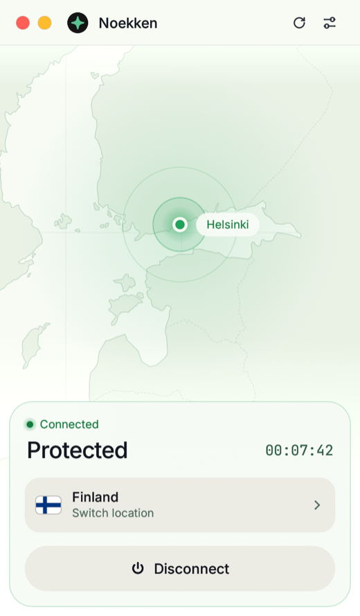
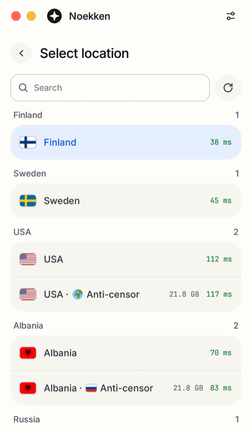
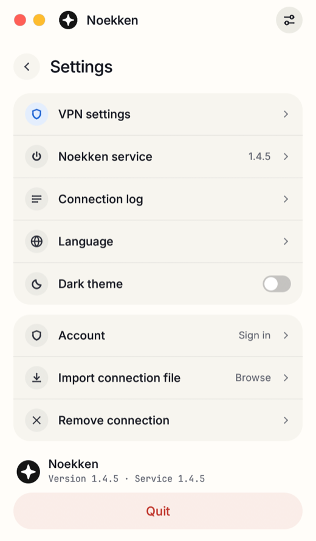

<div align="center">


# Noekken

**A VPN that does not ask who you are.**

No email, no password, no name: your account is a random key, and we keep only its hash.<br>
The tunnel looks like ordinary HTTPS, so networks that hunt for VPNs have little to go on.

[](https://github.com/houqai/noekken-app/releases/latest)


<br>

<a href="https://github.com/houqai/noekken-app/releases/download/v1.4.5/noekken-setup-1.4.5.exe"></a>
&nbsp;
<a href="https://github.com/houqai/noekken-app/releases/download/v1.4.5/Noekken-1.4.5-macos.dmg"></a>
&nbsp;
<a href="#linux"></a>
&nbsp;
<a href="https://github.com/houqai/noekken-app/releases/download/v1.4.5/Noekken-1.4.5-android.apk"></a>

<sub>Version 1.4.5 · <a href="https://github.com/houqai/noekken-app/releases">all versions</a> · <a href="https://noekken.com/download">noekken.com/download</a></sub>

<br><br>

<picture>
  <source media="(prefers-color-scheme: dark)" srcset="assets/connected-dark.png">
  
</picture>
&nbsp;
<picture>
  <source media="(prefers-color-scheme: dark)" srcset="assets/locations-dark.png">
  
</picture>
&nbsp;
<picture>
  <source media="(prefers-color-scheme: dark)" srcset="assets/settings-dark.png">
  
</picture>

</div>

## Get started

1. **Create an account** at [noekken.com](https://noekken.com/signup). One click gives you an account key: no email and no password.
2. **Install the app** for your system, see [Download](#download).
3. **Sign in with your account key.** The app fetches its connection file and keeps it up to date by itself.
4. **Pick a location and press Connect.**

## Why Noekken

- **Nothing that points to you.** An account is a random key. We have no email, name or password on file, so there is nothing about you to hand over and nothing to leak.
- **Hard to single out.** The tunnel looks like a regular TLS connection to a real website. Networks that block VPNs by the shape of their traffic have little to go on.
- **One file, every route.** Your connection file carries every location of your plan and several ways into each. If one address gets blocked, the app moves on to the next.
- **Anti-censor locations.** Locations marked *Anti-censor* reach the server through a CDN, for networks where direct connections are cut.
- **No leaks while reconnecting.** If the tunnel drops, the app keeps traffic from going around it until it is back.

## Download

| System | Files | Runs on |
|---|---|---|
| **Windows** | [Installer](https://github.com/houqai/noekken-app/releases/download/v1.4.5/noekken-setup-1.4.5.exe) · [Archive without an installer](https://github.com/houqai/noekken-app/releases/download/v1.4.5/Noekken-1.4.5-windows-x64.zip) | Windows 10 and 11, 64-bit |
| **macOS** | [Disk image](https://github.com/houqai/noekken-app/releases/download/v1.4.5/Noekken-1.4.5-macos.dmg) | macOS 11 or newer, Apple Silicon and Intel |
| **Linux** | [.deb x86_64](https://github.com/houqai/noekken-app/releases/download/v1.4.5/noekken_1.4.5_amd64.deb) · [.deb arm64](https://github.com/houqai/noekken-app/releases/download/v1.4.5/noekken_1.4.5_arm64.deb) · [.rpm x86_64](https://github.com/houqai/noekken-app/releases/download/v1.4.5/noekken-1.4.5-1.x86_64.rpm) · [.rpm arm64](https://github.com/houqai/noekken-app/releases/download/v1.4.5/noekken-1.4.5-1.aarch64.rpm) | Ubuntu 22.04+, Debian 12+, Fedora, RHEL 9 |
| **Android** | [APK](https://github.com/houqai/noekken-app/releases/download/v1.4.5/Noekken-1.4.5-android.apk) | Android 8 or newer, 64-bit |

### Windows

Run the installer. It asks for administrator rights: the app needs them to bring up its network adapter. Windows may warn about an unknown publisher: the installer has no paid certificate yet, so the checksum below is how you know the file is ours.

### macOS

Open the disk image and drag Noekken to Applications. The app is not notarized by Apple yet, so macOS stops its first launch: open **System Settings → Privacy & Security**, choose **Open Anyway** next to Noekken and confirm. Then the app installs its service and asks for the administrator password.

### Linux

In a terminal, in the folder with the downloaded package:

```bash
sudo apt install ./noekken_1.4.5_amd64.deb       # Ubuntu, Debian
sudo dnf install ./noekken-1.4.5-1.x86_64.rpm    # Fedora, RHEL
```

On arm64, take the arm64 file. Noekken then shows up among your apps. On GNOME the tray icon needs the AppIndicator extension: Ubuntu has it, Fedora and Debian do not out of the box.

### Android

Open the downloaded APK. The phone asks to allow installing apps from your browser: allow it, then install.

## Check the file

The SHA-256 of every file is shown next to it on the [release page](https://github.com/houqai/noekken-app/releases/tag/v1.4.5) and on [noekken.com/download](https://noekken.com/download). Compare it with yours:

```powershell
(Get-FileHash .\noekken-setup-1.4.5.exe -Algorithm SHA256).Hash.ToLower()
```

```bash
shasum -a 256 Noekken-1.4.5-macos.dmg
```

---

<div align="center">

[Website](https://noekken.com) · [Questions](https://noekken.com/#faq) · [Privacy policy](https://noekken.com/privacy) · [Terms of use](https://noekken.com/terms)

<sub>The files are kept on GitHub. When you download one, GitHub sees your address and we do not.</sub>

</div>
